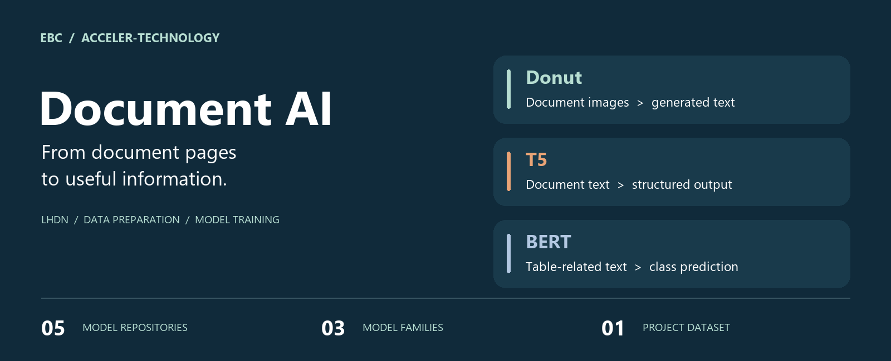
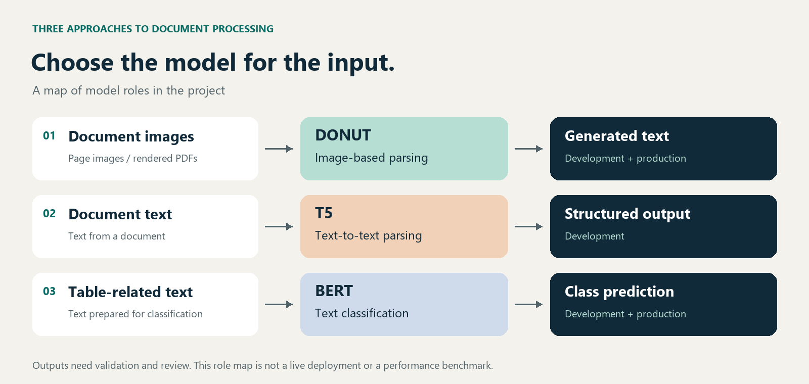
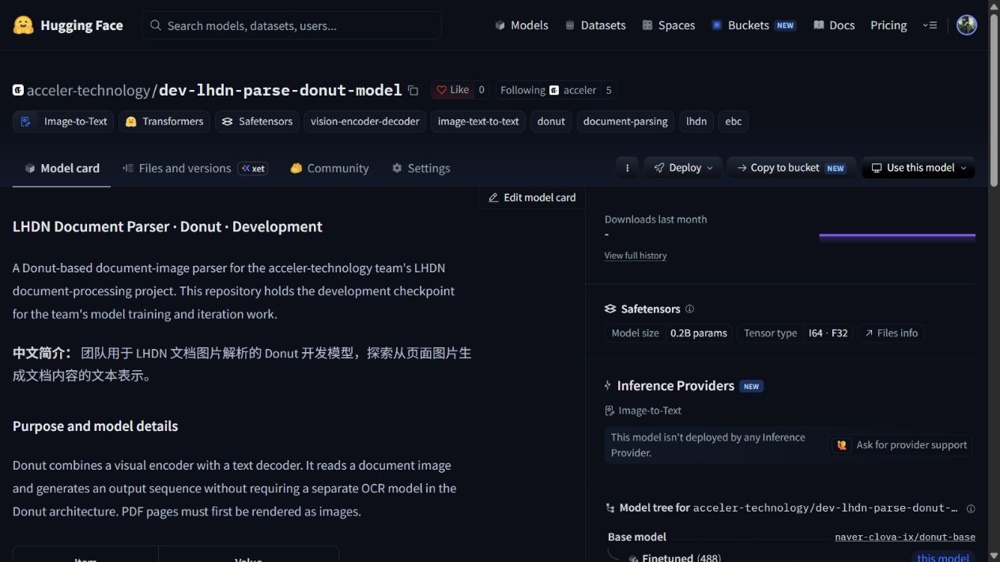

# EBC · LHDN Document AI

**A team project exploring how to turn documents into useful, structured information.**

We worked with **Donut for document images, T5 for text parsing, and BERT for table-related text classification**. Our Hugging Face organization holds five model repositories across these three families, plus the project's dataset repository.

[Hugging Face organization](https://huggingface.co/acceler-technology) · [My Hugging Face profile](https://huggingface.co/HenryTeo27) · [中文介绍](#中文介绍)

## The model map

*This diagram explains the model families' roles. It does not claim that all three run together in a deployed pipeline.*

## Explore the models

| Model | Purpose | Version | Explore |
| --- | --- | --- | --- |
| **Donut document parser** | Generates text representations of document content from page images | Development | [Hugging Face](https://huggingface.co/acceler-technology/dev-lhdn-parse-donut-model) · [Model card](model-cards/dev-lhdn-parse-donut-model/README.md) |
| **Donut document parser** | Preserves a production snapshot of the image-based parsing work | Production | [Hugging Face](https://huggingface.co/acceler-technology/prod-lhdn-parse-donut-model) · [Model card](model-cards/prod-lhdn-parse-donut-model/README.md) |
| **T5 text parser** | Explores converting document text into structured output | Development | [Hugging Face](https://huggingface.co/acceler-technology/dev-lhdn-parse-t5-model) · [Model card](model-cards/dev-lhdn-parse-t5-model/README.md) |
| **BERT table classifier** | Classifies text for the table-selection part of the project | Development | [Hugging Face](https://huggingface.co/acceler-technology/dev-lhdn-table-bert-model) · [Model card](model-cards/dev-lhdn-table-bert-model/README.md) |
| **BERT table classifier** | Preserves a production snapshot of the table-classification work | Production | [Hugging Face](https://huggingface.co/acceler-technology/prod-lhdn-table-bert-model) · [Model card](model-cards/prod-lhdn-table-bert-model/README.md) |

Five repositories represent **three model families**. Development and production repositories may hold different checkpoints. The `prod` name identifies a release snapshot; it does not establish a current live deployment.

All five model repositories are public. Their model cards and saved artifacts can be viewed without signing in.

### A look at the model cards

*An actual model-card screenshot. The text documents the artifact; this is not an inference-result screenshot.*

## Data and team contributions

The project's [lhdn-dataset](https://huggingface.co/datasets/acceler-technology/lhdn-dataset) contains PDF, scan, table-selection, and evaluation material. **The dataset remains private** and requires access. Source documents and personal records are not redistributed here.

**My role — Henry / [HenryTeo27](https://huggingface.co/HenryTeo27):** I led this part of the project, participated in model training and joint technical discussions, and handled the full execution of the data work. My teammate [kwyong](https://huggingface.co/kwyong) handled model uploads. The models are a team effort.

## A quick interview walkthrough

1. Start with the model map. Explain why images, document text, and classification need different approaches.
2. Open a model card to show its purpose, configuration, and saved model files.
3. Explain the development/production split and your own contribution to the data and training work.

This showcase presents saved model artifacts and project experience. Quantitative results and complete training recipes have not been published in these cards. Loading examples show the expected library interfaces; they are not end-to-end inference validation.

## 中文介绍

这是我们团队围绕 LHDN 文档处理开展的模型与数据工作。我们使用三类模型：**Donut 处理文档图片，T5 探索从文本生成结构化信息，BERT 处理表格选择相关的文本分类**。五个模型仓库包含开发版与生产快照。

面试时可以这样介绍：

> 我带领并参与了一个文档处理项目中的模型与数据工作。我们尝试了 Donut、T5 和 BERT 三类模型，分别处理文档图片、文本解析和表格相关分类。我主要负责这部分工作的带队、数据工作的全部执行，并参与模型训练和方案讨论；模型上传由队友执行。这里可以查看模型卡、配置文件和模型文件，了解各个模型的用途，以及开发版和生产快照的区别。

## About this repository

This repository keeps the showcase and readable copies of the five model cards. Model weights stay on Hugging Face. Private datasets stay in their original repository. This showcase assigns no license to model weights or datasets; check each artifact's terms before reuse.

